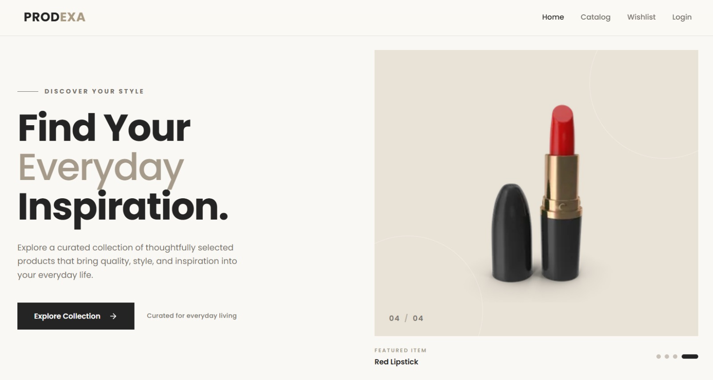
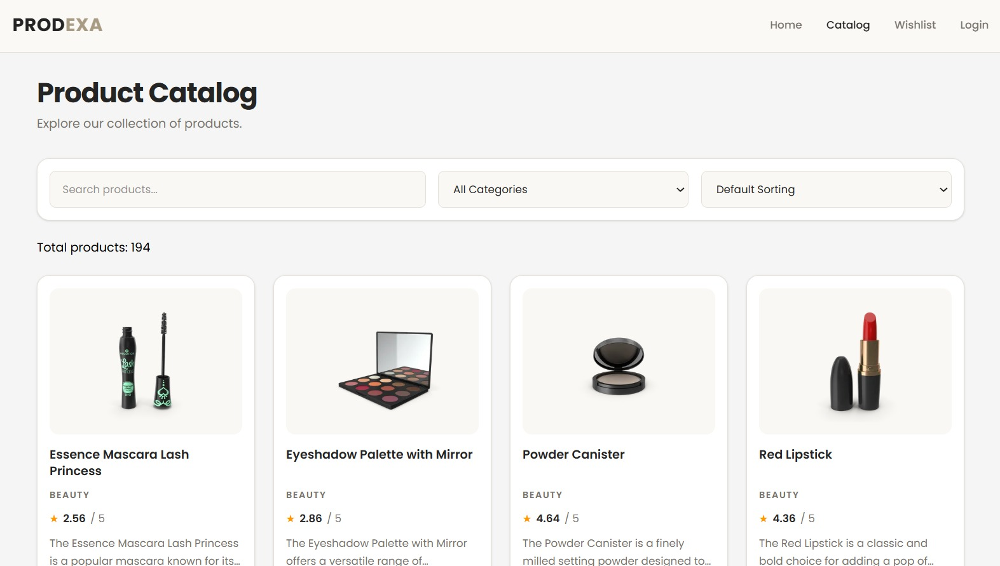
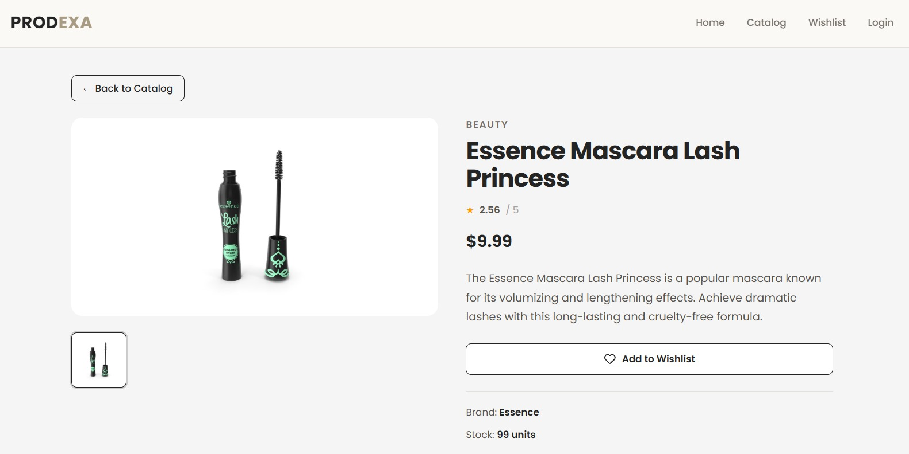
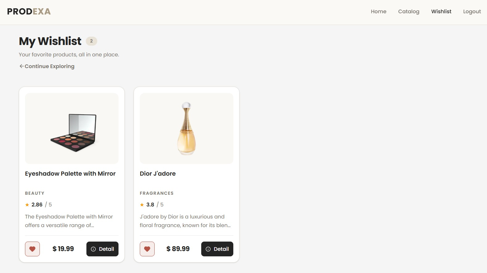
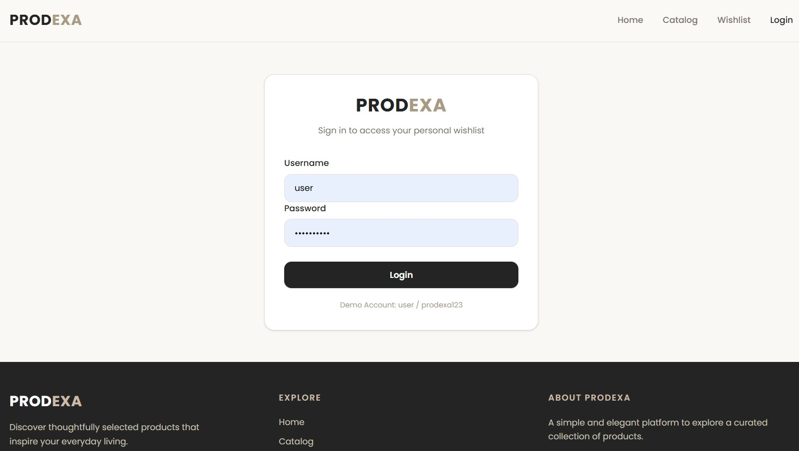
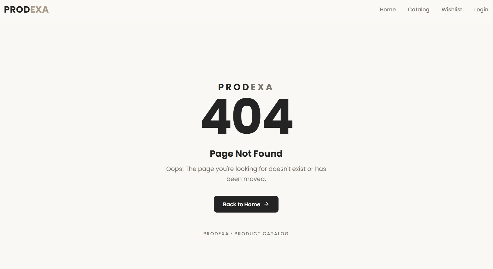

# Prodexa — Product Catalog

Prodexa is a responsive product catalog web application built with React.js. It allows users to explore products, view detailed product information, and save their favorite products to a personal wishlist.

## Features

- **Product Catalog** — Fetches and displays product data from DummyJSON API.
- **Home Page** — Displays featured products and product highlights.
- **Product Search** — Helps users find products in the catalog.
- **Product Details** — Displays product images, descriptions, prices, ratings, brand, and stock information.
- **Product Gallery** — Allows users to preview different product images.
- **User Authentication** — Provides a simple demo login and logout experience.
- **Wishlist** — Allows authenticated users to save and remove favorite products.
- **Wishlist Persistence** — Stores wishlist data in localStorage.
- **Protected Wishlist Route** — Requires users to log in before accessing their wishlist.
- **Loading and Error States** — Handles loading processes, API errors, and unavailable products.
- **Empty State** — Displays helpful messages when the wishlist contains no products.
- **404 Not Found Page** — Provides a custom page for unavailable routes.
- **Responsive Design** — Supports desktop, tablet, and mobile screens.
- **Custom Branding** — Uses a minimalist Charcoal & Beige theme with a custom logo and favicon.

## Screenshots

### Home Page


### Product Catalog


### Product Detail


### Wishlist


### Login


### Not Found


## Technologies

- React.js
- JavaScript (ES6+)
- Vite
- Tailwind CSS
- React Router DOM
- Lucide React
- Fetch API
- DummyJSON API
- HTML5
- CSS3
- Git and GitHub

## API

Product data is retrieved from:

https://dummyjson.com/products

The application uses the DummyJSON API to retrieve product information and display the product catalog and details.

## Getting Started

### Prerequisites

Make sure you have the following installed:

- Node.js
- npm
- Git

### Installation

1. Clone this repository:

   ```bash
   git clone YOUR_GITHUB_REPOSITORY_URL
   ```

2. Navigate to the project directory:

   ```bash
   cd prodexa
   ```

3. Install dependencies:

   ```bash
   npm install
   ```

4. Start the development server:

   ```bash
   npm run dev
   ```

5. Open the local URL displayed in your terminal.

## Demo Authentication

Prodexa uses simple client-side authentication for demonstration purposes.

The wishlist feature is available only to authenticated users.

**Note:** This is a demo authentication system and does not implement production-level security or server-side authentication.

## Project Structure

```text
prodexa/
├── public/
│   └── prodexa-logo.webp
│
├── src/
│   ├── assets/
│   │   ├── hero.png
│   │   ├── react.svg
│   │   └── vite.svg
│   │
│   ├── components/
│   │   ├── Footer.jsx
│   │   ├── NavBar.jsx
│   │   └── ProductCard.jsx
│   │
│   ├── pages/
│   │   ├── Catalog.jsx
│   │   ├── DashboardPage.jsx
│   │   ├── Home.jsx
│   │   ├── LoginPage.jsx
│   │   ├── NotFound.jsx
│   │   ├── ProductDetail.jsx
│   │   └── Wishlist.jsx
│   │
│   ├── routes/
│   │   └── AppRoutes.jsx
│   │
│   ├── services/
│   │   ├── LoginService.js
│   │   ├── ProductService.js
│   │   └── WishlistService.js
│   │
│   ├── App.css
│   ├── App.jsx
│   ├── index.css
│   └── main.jsx
│
├── index.html
├── package.json
└── README.md
```

## Implementation Notes

- React Hooks such as `useState` and `useEffect` manage application state and API requests.
- React Router DOM handles page navigation and protected routes.
- Reusable components are used to maintain a consistent interface.
- Service functions separate application logic from UI components.
- Fetch API and async/await handle external API requests.
- Conditional rendering handles loading, error, empty, and authenticated states.
- localStorage persists wishlist data between browser sessions.
- Tailwind CSS provides responsive styling and consistent UI design.

## Testing

- [ ] Browse products on the Home page.
- [ ] Open the Product Catalog.
- [ ] Search for products.
- [ ] Open product details.
- [ ] Switch product gallery images.
- [ ] Test login and logout.
- [ ] Add products to Wishlist.
- [ ] Remove products from Wishlist.
- [ ] Verify wishlist persistence after refreshing.
- [ ] Verify protected Wishlist access.
- [ ] Test loading, error, and empty states.
- [ ] Test the 404 Not Found page.
- [ ] Verify responsive layouts.
- [ ] Run ESLint and production build.

## Author

Developed as a personal Front-End Developer portfolio project.
